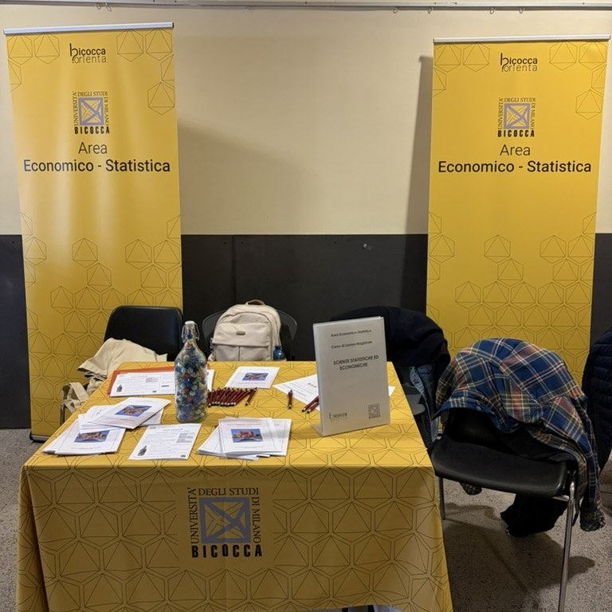
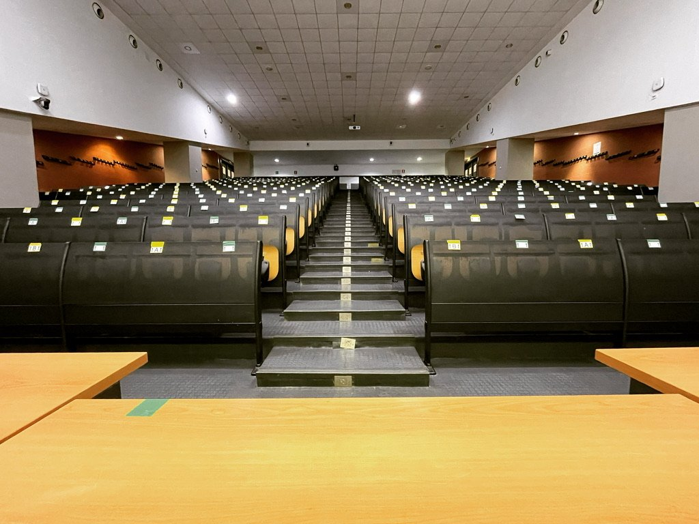
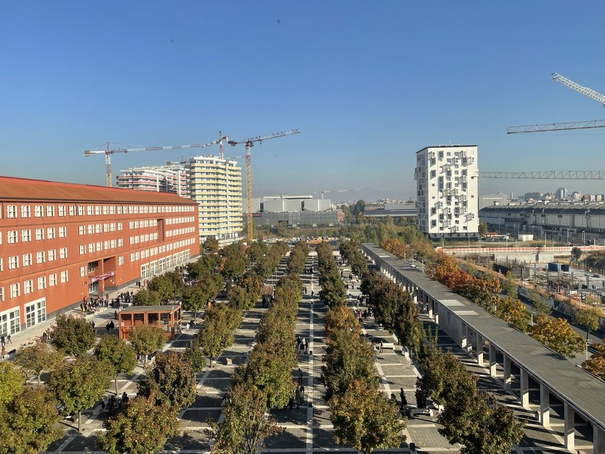
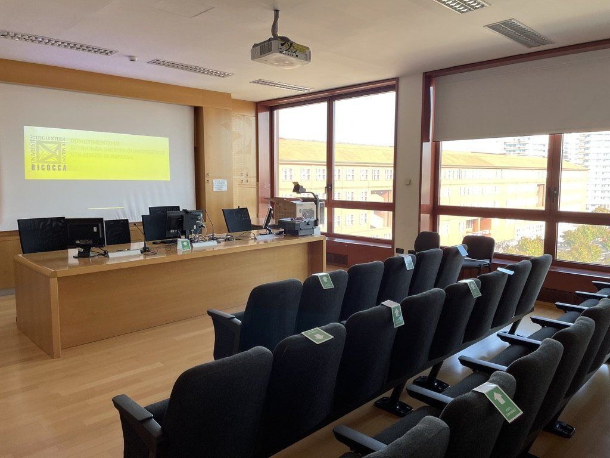
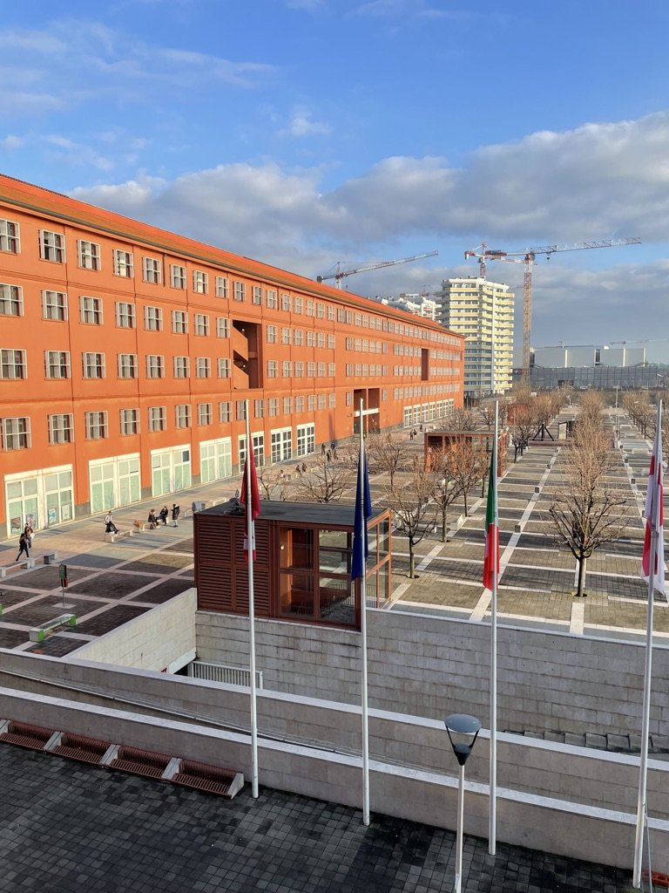
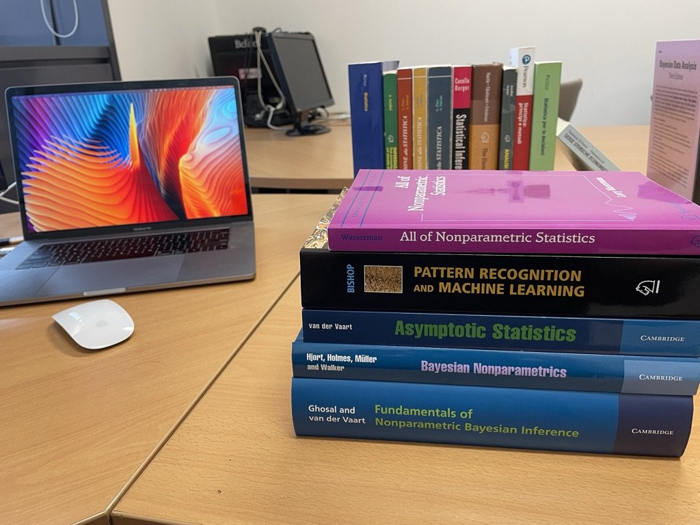
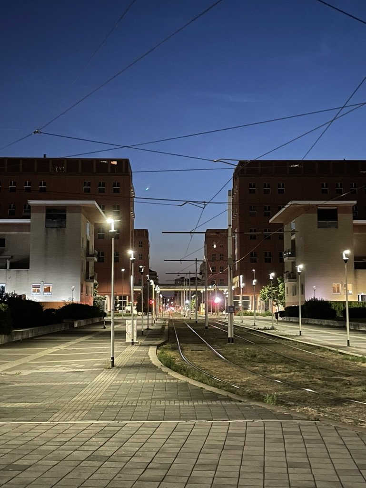

:::: {#registrazione .ev-cta}
::: {}
[Iscrizioni]{.ev-k}

**Evento gratuito, iscrizione obbligatoria**

I posti sono limitati: per partecipare è necessario iscriversi tramite il [modulo online](https://forms.gle/E6Y3GA6wzYYPTAeaA).
:::

::: {.ev-cta-actions}
[[]{.bi .bi-calendar-plus aria-hidden="true"} Aggiungi al calendario](statistica-impresa-finanza-2027.ics){.btn .ev-btn download="statistica-impresa-finanza-2027.ics"}

[Iscriviti](https://forms.gle/E6Y3GA6wzYYPTAeaA){.btn .ev-btn}
:::
::::

:::: {.ev-split layout="[58,42]" layout-valign="center"}
::: {}
[Una giornata di incontro tra studentesse e studenti dei corsi di laurea triennale (SSE) e magistrale ([CLAMSES](https://www.unimib.it/magistrale/scienze-statistiche-economiche)) in Scienze Statistiche ed Economiche e il mondo del lavoro.]{.ev-lead}

Interverranno ex studenti e ex studentesse di Statistica a Bicocca che oggi lavorano in azienda, nell'impresa e nella finanza, insieme a manager e referenti di aziende che assumono statistici e data scientist.

L'obiettivo è duplice: offrire un orientamento concreto verso i segmenti qualificati del mercato del lavoro più vicini al nostro corso di laurea, e creare un'occasione di networking tra studenti, laureati e aziende.
:::

{fig-alt="Lo stand dell'Area Economico-Statistica di Milano-Bicocca"}
::::

::: {.ev-facts}
::: {}
[Quando]{.ev-k} **Giovedì 20 maggio 2027** [ore 10.00–17.00]{.ev-s}
:::

::: {}
[Dove]{.ev-k} **Aula Martini** [Università di Milano-Bicocca]{.ev-s}
:::

::: {}
[Per chi]{.ev-k} **Studenti e laureati SSE e CLAMSES**
:::

::: {}
[Formato]{.ev-k} **Talk, short talk, tavola rotonda** [con pranzo e due coffee break]{.ev-s}
:::
:::

## A chi è rivolto

:::: {.ev-split .ev-flip layout="[40,60]" layout-valign="center"}
{fig-alt="Un'aula del campus di Milano-Bicocca"}

::: {}
Alle studentesse, agli studenti e ai laureati dei corsi di laurea triennale (SSE) e magistrale (CLAMSES) in Scienze Statistiche ed Economiche, in particolare a chi sta per laurearsi o sta scegliendo come orientare il proprio percorso dopo la laurea.

La partecipazione è gratuita, ma i posti sono limitati e l'[iscrizione](#registrazione) è obbligatoria.
:::
::::

## Programma

::: {.sem-card .ev-next}
::: {.sem-date}
[20]{.sem-day}

[maggio]{.sem-month}

[giovedì 2027]{.sem-wday}
:::

::: {.sem-body}
[Programma provvisorio]{.chip .chip-note}

### Orari della giornata {.sem-title}

La giornata alterna interventi invitati, una sessione di short talk e una tavola rotonda conclusiva, con una pausa pranzo e due coffee break pensati anche come momenti di incontro.

| Orario | |
|---|---|
| 10.00–10.05 | Saluti istituzionali e introduzione alla giornata |
| 10.05–11.20 | **Interventi invitati**: due talk |
| 11.20–11.45 | *Coffee break* |
| 11.45–13.00 | **Short talk**: dodici interventi da 5 minuti |
| 13.00–14.00 | *Pausa pranzo* |
| 14.00–15.15 | **Interventi invitati**: due talk |
| 15.15–15.45 | *Coffee break* |
| 15.45–16.45 | **Tavola rotonda** |
| 16.45–17.00 | Chiusura |

Gli orari dei blocchi sono fissati. Relatori e aziende partecipanti saranno annunciati qui man mano che gli interventi vengono confermati.
:::
:::

## Organizzazione

L'evento è organizzato da [Roberto Ascari](https://robertoascari.github.io/), [Riccardo Borgoni](https://www.unimib.it/riccardo-borgoni), [Tommaso Rigon](https://tommasorigon.github.io) e [Giorgia Zaccaria](https://giorgiazaccaria.github.io), a cui ci si può rivolgere per informazioni.

:::: {#galleria .ev-gallery .column-body-outset}
::: {.ev-strip}
{.lightbox group="galleria" fig-alt="Il campus di Milano-Bicocca visto dall'alto"}

{.lightbox group="galleria" fig-alt="Un'aula del campus"}

{.lightbox group="galleria" fig-alt="Gli edifici del campus di Milano-Bicocca"}

{.lightbox group="galleria" fig-alt="Libri di statistica su una scrivania"}

{.lightbox group="galleria" fig-alt="Il campus di Milano-Bicocca di sera"}
:::
::::

```{=html}
<script>
document.querySelectorAll('.ev-gallery').forEach(function (g) {
  var strip = g.querySelector('.ev-strip');
  function btn(cls, label, dir) {
    var b = document.createElement('button');
    b.type = 'button'; b.className = 'ev-nav ' + cls; b.setAttribute('aria-label', label);
    b.addEventListener('click', function () { strip.scrollBy({left: dir * strip.clientWidth * 0.8, behavior: 'smooth'}); });
    g.appendChild(b); return b;
  }
  var prev = btn('ev-prev', 'Foto precedenti', -1), next = btn('ev-next-btn', 'Foto successive', 1);
  function update() {
    prev.disabled = strip.scrollLeft < 5;
    next.disabled = strip.scrollLeft + strip.clientWidth > strip.scrollWidth - 5;
  }
  strip.addEventListener('scroll', update); window.addEventListener('resize', update);
  window.addEventListener('load', update); update();
});
</script>
```
